<p align="center">
  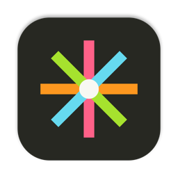
</p>

<h1 align="center">Claude Productivity For Meta Display</h1>
<p align="center"><b>ClaudeProd</b>: your Claude Code sessions on Meta Ray-Ban Display glasses.</p>

<p align="center">
  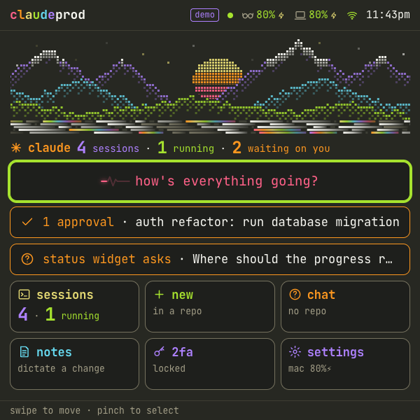
  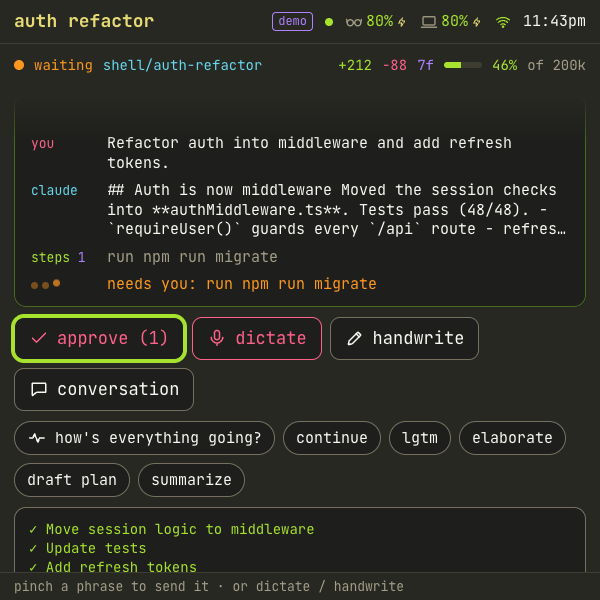
</p>

Watch every Claude Code session from your glasses: the ones it starts, the ones already running
in your terminal, VS Code or Remote Control, and the ones on machines you SSH into. Watch each
session work in a live feed, with how full its context window is. Approve a command with a swipe,
answer Claude's questions, read what it said, and reply by voice or with a one-pinch phrase. Ask
**"how's everything going?"** and swipe through a status card per session, in its own words, with
the ones waiting on you first. Dictate changes to your Apple Notes to-do list with the **notes**
tile. Maps, messages and photos are left to the glasses' own apps.

It's two parts: a 600×600 **web app** for the glasses, and a **relay** on your Mac that runs the
sessions and serves the app over HTTPS. The **ClaudeProd menu bar app** sets both up and runs them.

---

## Setup (about 10 minutes)

### What you need

| | |
|---|---|
| Meta Ray-Ban Display + the Meta AI app on your iPhone | Meta AI app v272+, glasses v125+ |
| A Mac with Node 20+ | `node -v` (install: `brew install node`) |
| Claude Code, signed in | `claude`, then `/login` once |
| Xcode Command Line Tools | `xcode-select --install` (for the menu bar app) |
| Tailscale (recommended) | `brew install --cask tailscale`, then sign in. It gives the relay a permanent HTTPS address. Without it, a Cloudflare quick tunnel is used (`brew install cloudflared`), whose address changes on every start |

### 1. Turn on Developer Mode in the Meta AI app (once)

Meta AI app → **Settings → App Info** → tap the **App version** number **five times** → **Enable**.

### 2. Get the code and build the Mac app

```bash
git clone https://github.com/karthiksing05/karthik-meta-display-os.git
cd karthik-meta-display-os
npm run app
```

`npm run app` builds **ClaudeProd.app** into `~/Applications` and opens it. Its icon appears in
your menu bar, and it sets everything up by itself:

- installs dependencies and writes `relay/.env` with a random `SHELL_TOKEN`
- installs Claude Code hooks, so sessions you start in a terminal, VS Code or Remote Control show up live
- builds the glasses app, opens the HTTPS tunnel and starts the relay
- makes the install QR

The first time Tailscale Funnel is used, Tailscale may ask you to approve it for your tailnet. If the
panel says it couldn't start, click **Log** to see why.

<p align="center">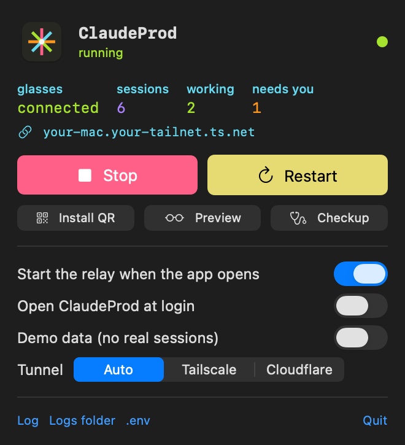</p>

### 3. Install it on the glasses

In the menu bar panel, click **Install QR**. It refreshes the address, regenerates the QR and checks
that the address answers. Then:

1. Point your **iPhone camera** at the QR and tap the link.
2. The Meta AI app asks to add **Claude Productivity For Meta Display**. "Unverified" is expected for your own apps.
3. Open it on the glasses. A green dot in the header means it's connected.

You only do this once. Updates reach the glasses on their own.

### 4. Lock it (strongly recommended)

The install link carries a secret token. Without a lock, anyone who gets that link (from a
screenshot of the QR, say) could drive your Claude sessions. Add a lock in `relay/.env`
(**.env** in the panel's footer opens it):

```bash
APP_PATTERN=up up left right down left    # a swipe pattern you unlock with on the glasses (6+ moves)
APP_PASSWORD=                             # and/or a password (handy in a browser)
APP_LOCK_HOURS=12                         # how long an unlock lasts on a device
```

Save the file and the relay restarts by itself. From then on the app shows nothing until you swipe
the pattern and pinch. 5 wrong tries lock it for 15 minutes.

<p align="center">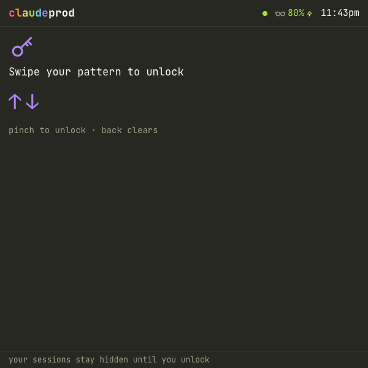</p>

### Optional extras

| | How |
|---|---|
| Cleaner dictated replies | a free key from console.groq.com → `GROQ_API_KEY` in `relay/.env` |
| 2FA codes on the lens | read [docs/TWO_FACTOR.md](docs/TWO_FACTOR.md), then `npm run 2fa -- --image <export-QR screenshot>` |
| Apple Notes (the notes tile) | nothing to set up: the first time, macOS asks once on the Mac whether ClaudeProd may control Notes. Each rewrite backs up the old note to `DATA_DIR/notes-backups` |
| Sessions on machines you SSH into | `npm run hooks -- remote user@host` once per machine (needs `curl` and `python3` there). They show up tagged with the machine's name ([docs/SERVER.md](docs/SERVER.md#sessions-on-machines-you-ssh-into)) |
| Repos for new sessions | `REPOS_DIR` in `relay/.env` (the folder that holds your git repos, searched 3 levels deep) |
| Start at login | the **Open ClaudeProd at login** switch in the panel |
| Check everything | **Checkup** in the panel (or `npm run doctor`) |

No glasses yet? Turn on **Demo data** in the panel and click **Preview**: the app opens in your
browser with fake sessions. Arrow keys = swipes, Enter = pinch, Esc = back.

---

## Using it

| On the glasses | Does |
|---|---|
| Swipe (thumb on the Neural Band) | move between controls, scroll |
| Pinch (index finger) | select |
| Middle-finger tap | back |

<table>
<tr>
<td align="center" width="33%"><br><b>home</b>: how many sessions and how many are running, "how's everything going?", approvals, Claude's questions, then sessions, new, chat, notes, 2fa, settings</td>
<td align="center" width="33%">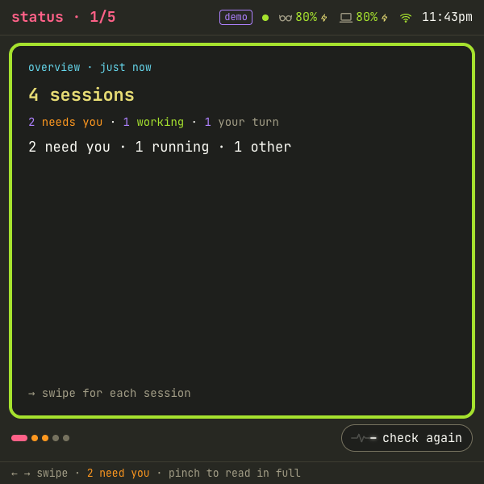<br><b>status</b>: swipe ← → through an overview and a card per session (its own answer, what changed since last time); pinch the button again while it's asking to cancel</td>
<td align="center" width="33%">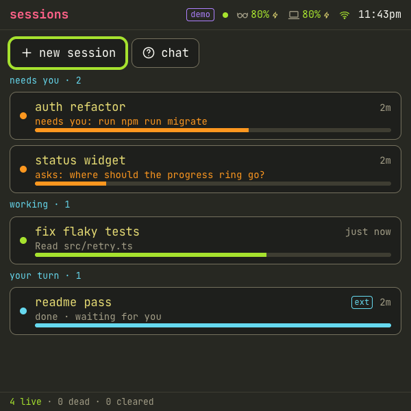<br><b>sessions</b>: needs you / working / your turn / earlier; <b>clear N dead</b> hides stopped and long-idle ones</td>
</tr>
<tr>
<td align="center">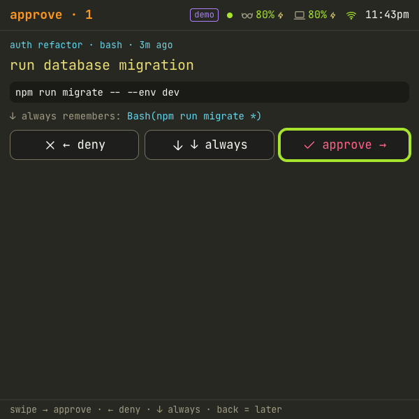<br><b>approve</b>: → approve, ← deny, ↓ always allow this kind</td>
<td align="center">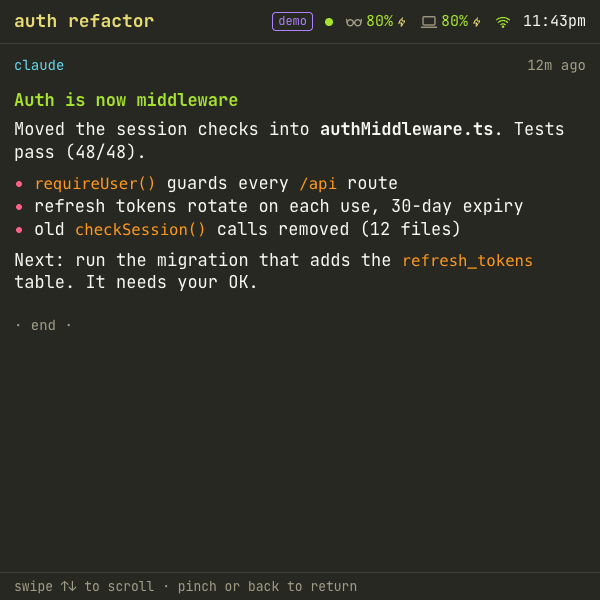<br><b>read</b>: pinch the feed for the whole conversation, then a message to read all of it</td>
<td align="center">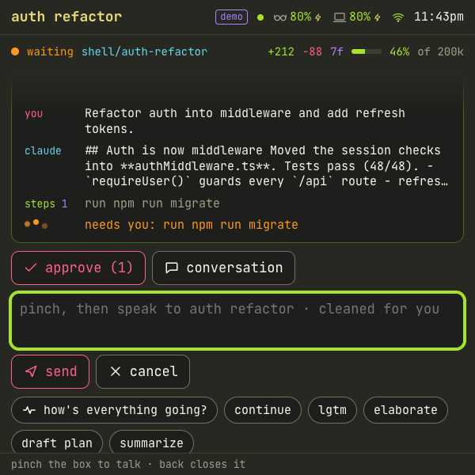<br><b>reply</b>: <i>dictate</i> (cleaned FreeFlow-style) or <i>handwrite</i> (sent as written); the box opens in place</td>
</tr>
<tr>
<td align="center">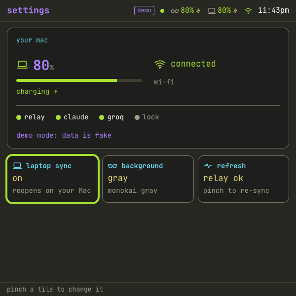<br><b>settings</b>: your Mac's battery and Wi-Fi, what's connected, laptop sync, background</td>
<td align="center">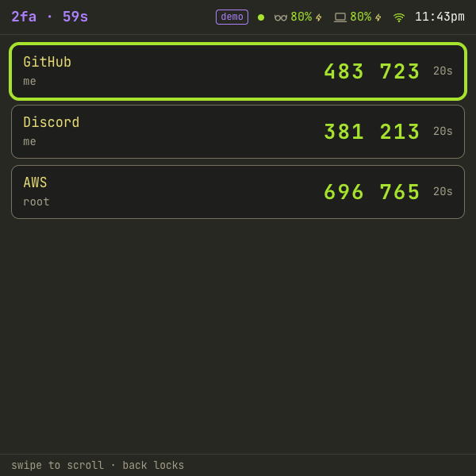<br><b>2fa</b>: codes after your pattern; back locks them</td>
<td align="center"><br><b>lock</b>: nothing shows until you unlock</td>
</tr>
</table>

**A session** shows a live feed: new steps and messages slide in and flash, and older ones scroll
up and out. A small gauge shows how full its context window is (green, then orange past 60%, pink past 80%).
Pinch the feed for the whole conversation. The green border is always where you are.

**Clearing dead sessions.** Stopped, errored and sessions idle for 3+ hours count as dead. **clear N
dead** on the sessions screen, or **clear from list** on one session, hides them. Nothing is
deleted: one comes back if it does anything new, and **show N cleared** brings them all back.

**Notes.** The **notes** tile opens dictation straight away. It goes to one long-lived Claude session
that reads your Apple Notes, finds your main to-do list and adds to it neatly (one task per line,
grouped, duplicates merged). Notes sync to your iPhone through iCloud. Checkboxes can't be written by
script, so checklist items come out as bullets.

**Quick phrases** on every session send with one pinch: *continue*, *lgtm*, *elaborate*,
*draft plan*, *summarize*. Change them in `~/.claude-shell/data/phrases.json`.

**Your laptop stays in sync.** Replying from the glasses continues the same session. When the turn
is done, ClaudeProd reopens that session in VS Code (or your terminal), so it shows every turn. A
VS Code tab that's already open can't refresh itself, so the lens tells you when one is out of date.

**Approvals** follow a preset, `approvals` in `~/.claude-shell/data/settings.json` (restart the relay after editing): *careful*, *balanced* (default), *trusting*,
or *everything* (auto-approve all). Risky commands (`rm -rf`, `git push`, `sudo`, …) always ask,
except under *everything*.

**Chat** starts a one-off with no repo, with your claude.ai connectors (Drive, Slack, Canva, …).

---

## Commands

| Command | Does |
|---|---|
| `npm run app` | build and install the menu bar app (it runs everything below for you) |
| `npm run up` | the same stack from a terminal: deps, `.env`, hooks, build, tunnel, relay, QR. Leave it running and edits go live (`-- --demo` for fake data) |
| `npm run doctor` | check the relay, address, Claude login, repos, hooks, lock, Groq and 2FA, and say what to fix |
| `npm run hooks -- install` | show your terminal / VS Code / Remote Control sessions on the lens (`up` does this for you) |
| `npm run hooks -- remote user@host` | the same for a machine you SSH into (`remote-remove` undoes it) |
| `npm run 2fa -- --image <file>` | import 2FA accounts from an Authenticator export QR ([docs/TWO_FACTOR.md](docs/TWO_FACTOR.md)) |
| `npm run qr` | print the install QR again |
| `npm run dev:demo` | hot-reloading app on :5173 with fake data, for working on the UI |
| `npm run deploy` | update an always-on server after `git push` ([UPLOAD.md](UPLOAD.md)) |
| `npm run typecheck` | check both halves |

## Docs

| | |
|---|---|
| [docs/PUSH_TO_GLASSES.md](docs/PUSH_TO_GLASSES.md) | installing on the glasses, addresses, updates, input, troubleshooting |
| [docs/SERVER.md](docs/SERVER.md) | the relay: sessions, worktrees, outside and SSH sessions, status checks, notes, approvals, lock, endpoints |
| [docs/TWO_FACTOR.md](docs/TWO_FACTOR.md) | 2FA codes on the lens, and the trade-off |
| [docs/ARCHITECTURE.md](docs/ARCHITECTURE.md) | how it fits together, adding a screen |
| [UPLOAD.md](UPLOAD.md) | running the relay on an always-on server instead of your Mac |

```
├── glasses/   the 600×600 web app (TypeScript + Vite, no framework)
├── relay/     the server: Claude Agent SDK sessions, approvals, hooks, lock, 2FA (Node + TypeScript)
├── shared/    protocol.ts, the message types both sides use
├── mac/       the ClaudeProd menu bar app (Swift, built with swiftc; no Xcode project)
├── deploy/    up.sh (one-command setup), server setup and update scripts
└── docs/      the guides above, and the screenshots (demo data)
```
